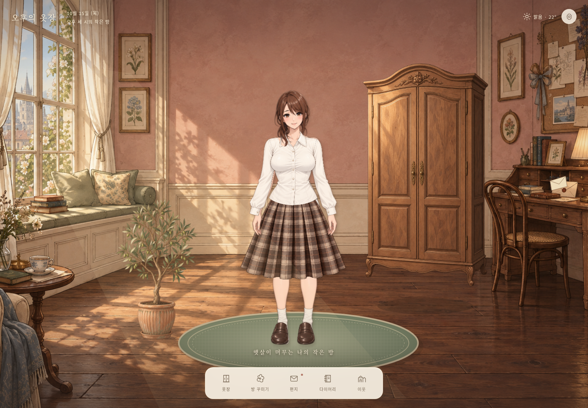
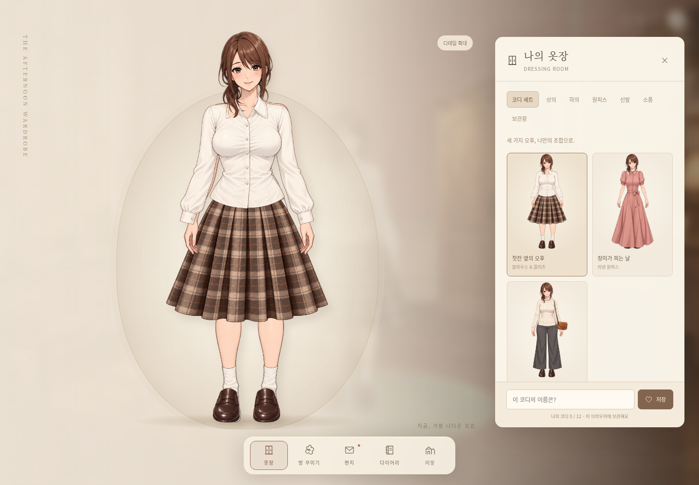

# 오후의 옷장

어른을 위한 서정적인 2D 코디·생활 게임입니다. React + Vite + styled-components를 사용하며 API 키나 백엔드 없이 실행합니다.





## PC에서 실행

Node.js 24 LTS를 권장합니다. 지원 범위는 Node.js 20.19+ 또는 22.12+입니다.

```sh
npm ci
npm run dev
```

터미널에 표시된 로컬 주소로 접속하세요. 프로덕션 빌드와 확인:

```sh
npm run build
npm run preview
```

## 조작

- 첫 화면 전체가 방입니다. 옷장·인형·러그·화분·편지를 누르거나 하단 도구 모음을 사용합니다.
- 옷장: 큰 인형을 보며 세트 또는 상의·하의·원피스·신발·소품을 고릅니다. 상·하의를 고르면 원피스를 벗습니다. 디테일 확대 버튼으로 의상을 더 크게 살펴볼 수 있습니다.
- 코디: 이름을 붙여 12개까지 저장하며 보관함에서 다시 입거나 삭제합니다.
- 방 꾸미기: 벽 색, 러그 색, 올리브 화분의 유무를 변경합니다.
- 편지: 편지를 읽고 마음에 간직합니다.
- 다이어리: 제목, 내용, 기분과 그때의 코디를 함께 기록합니다.
- 이웃: 3명의 샘플 공간을 둘러보고 인사를 남깁니다. 실제 다른 사용자와 통신하지 않습니다.
- `Esc` 또는 패널의 닫기 버튼으로 방에 돌아옵니다. 키보드 Tab/Enter로 물체와 도구를 조작할 수 있습니다.
- 설정에서 작은 움직임을 끌 수 있습니다. OS의 모션 감소 설정도 따릅니다.

기록은 현재 브라우저의 localStorage(`afternoon-closet-v1`)에 저장됩니다. 다른 기기와 동기화되지 않으며 브라우저 데이터 삭제 시 사라집니다. 이전 버전의 코디 ID를 새로운 에셋으로 변환하고, 이전 원본을 `afternoon-closet-v1-backup`에 한 번 보관합니다. 새 아바타는 갈색 헤어 1종을 사용하므로 이전 헤어·장식은 기본값으로 매핑합니다. 화면의 날씨와 오후 세 시는 게임 속 설정이고, 날짜는 서울 시간입니다.

## 그래픽과 코드

- `public/art/`: 투명 캐릭터·의상·소품 및 방 일러스트. **앱 배포 시 이 폴더 전체가 필요합니다.**
- `src/components/Avatar.jsx`: 기준 인형 좌표계, 의상 등록 및 앞머리·손·기본 복장 마스크
- `src/components/Room.jsx`: 방 장면, 독립 가구, 상호작용 영역, 작은 움직임
- `src/game.js`: 의상 카탈로그, 코디·저장 데이터 마이그레이션
- `src/styles.js`: 전체 화면 게임 UI, 반응형 패널 및 피팅 무대
- `src/main.jsx`: 옷장과 기존 기능 패널
- [일러스트 목록·레이어 규격과 한계](docs/ART.md)
- [검증한 화면](docs/screenshots/)

## 브라우저 검증

```sh
npx playwright install chromium
npm test
```

시스템 Chromium이 `/usr/bin/chromium`에 있으면 자동으로 사용합니다. 다른 경로는 `PLAYWRIGHT_CHROMIUM_EXECUTABLE` 환경변수로 지정할 수 있습니다. 기본 테스트 서버는 5176 포트를 사용하며, 이미 실행한 서버는 `TEST_BASE_URL`로 지정합니다.

기능 테스트는 코디 조합·원피스 전환·저장과 복원·데이터 마이그레이션·방 꾸미기·편지·다이어리·이웃·설정을 포함합니다. 1440×1000, 768×1024, 390×844, 360×640, 844×390 화면에서 패널과 도구 모음의 범위 및 피팅 인형이 패널에 가리지 않는지 확인합니다.
